# [kathir world](https://world.kathirm.com)

Welcome to `kathir world`. This started as a gamified personal portfolio that I made in college. It previously only ran on client, and then evolved into a full-fledged sandbox-style game after I decided to augment it a little bit to test out a feature I built out at Modal called [Sticky Sessions](https://modal.com/blog/serverless-routing-made-sticky).

Visit [world.kathirm.com](https://world.kathirm.com) to give it a shot. And read the [guide](https://world.kathirm.com/guide/)!

## Photo Gallery

  <a href="packages/client/public/assets/guide/gallery/krusty-krab.jpg">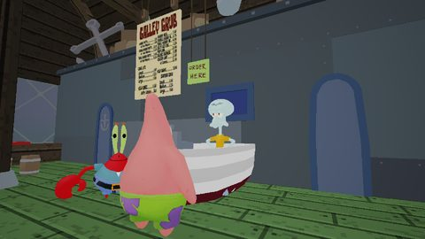</a>
  <a href="packages/client/public/assets/guide/gallery/living-room.jpg">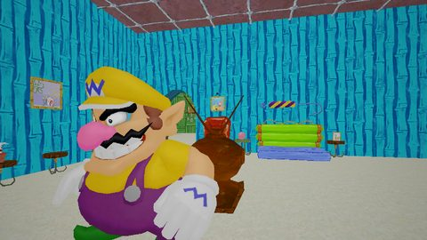</a>
  

  <a href="packages/client/public/assets/guide/gallery/cast.jpg">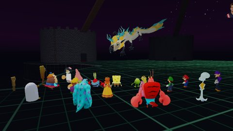</a>
  <a href="packages/client/public/assets/guide/gallery/colgera.jpg">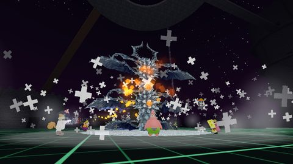</a>
  <a href="packages/client/public/assets/guide/gallery/kart-drift.jpg">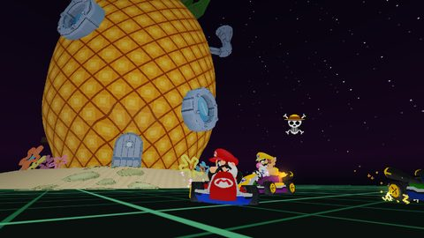</a>

  <a href="packages/client/public/assets/guide/gallery/sky-bridge.jpg">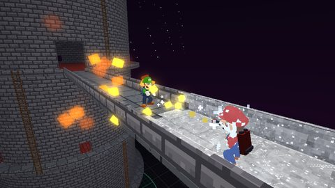</a>
  <a href="packages/client/public/assets/guide/gallery/light-dragon.jpg">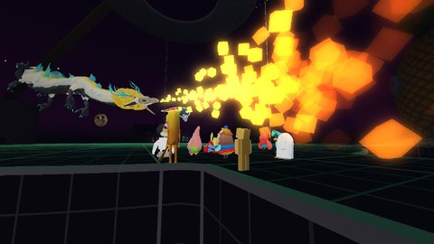</a>
  <a href="packages/client/public/assets/guide/gallery/staircase.jpg">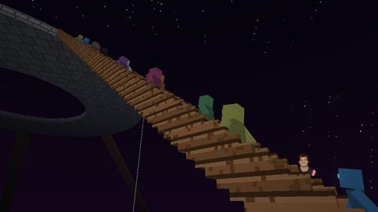</a>

  <a href="packages/client/public/assets/guide/gallery/pineapple.jpg">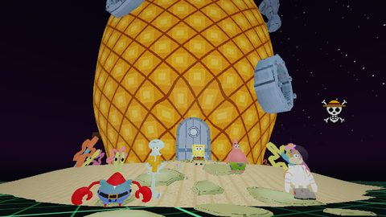</a>
  <a href="packages/client/public/assets/guide/gallery/terrace.jpg">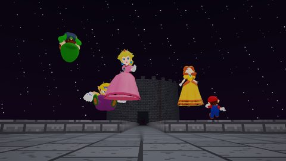</a>
  <a href="packages/client/public/assets/guide/gallery/anime-building.jpg">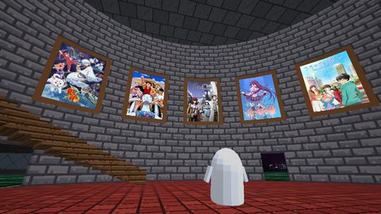</a>

